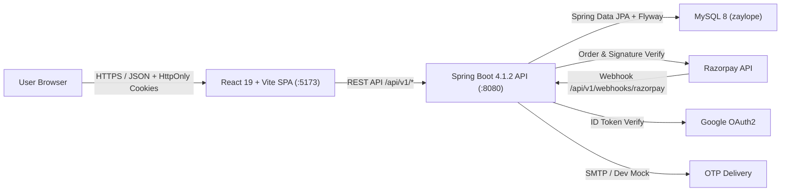

# System Architecture

ZayloPe is a two-tier web application consisting of a React 19 SPA (`frontend/`, port `5173`) and a Spring Boot 4.1.2 REST API (`backend/`, port `8080`) backed by MySQL 8 (`zaylope` schema).

## Trust Boundaries
- **Browser ↔ Backend**: Authenticated via HTTP-only cookies (`ZAYLOPE_APPLICANT`, `ZAYLOPE_ONBOARDING`) validated by `ApplicantSessionFilter`.
- **Payment Verification**: Never trusted from client-only callbacks; verified server-side via Razorpay HMAC signature and webhook handlers.
- **Database**: `spring.jpa.hibernate.ddl-auto=none`; schema evolution is strictly managed via Flyway (`V1`–`V13`).
