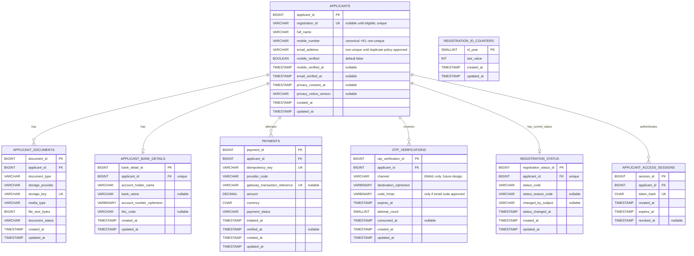

# Phase I MySQL ER Diagram

The diagram includes the initially proposed domain tables, the `registration_id_counters` support table for future ID allocation, and `applicant_access_sessions` for the implemented applicant cookie. Internal primary keys are `BIGINT UNSIGNED`; public registration IDs are separate and nullable until issuance.

> Current implementation note: OTP-related verification designs are historical only. No OTP provider or verification endpoint is active; existing schema and records are preserved.

## Cardinality and design notes

- `||--o{`: each child row belongs to exactly one applicant; an applicant may have zero or many child rows.
- `||--o|`: each optional dependent row belongs to exactly one applicant; an applicant may have zero or one current row. The unique FK on `applicant_id` enforces this 1:1 maximum.
- `registration_id_counters` has no direct FK to applicants; it allocates sequence values transactionally by year.
- Documents point to private storage references; file bytes are not stored in MySQL.
- Bank account ciphertext is application-encrypted and must not be exposed in general applicant responses.
- MSG91 owns SMS OTP generation and verification. No mobile OTP or OTP hash is persisted; `OTP_VERIFICATIONS` is a future email-only design and is not part of V1/V2.
- Registration currently creates an applicant session whose opaque bearer token is sent only in an HttpOnly cookie; MySQL stores only the SHA-256 token hash. V2 defines this table but has not been applied.
- The status table stores current state only. Add a dedicated append-only history entity if the client requires audit history.
- Contact uniqueness, verification prerequisites, document cardinality/limits, status values, and ID issuance conditions are **PENDING CLIENT CONFIRMATION**.

